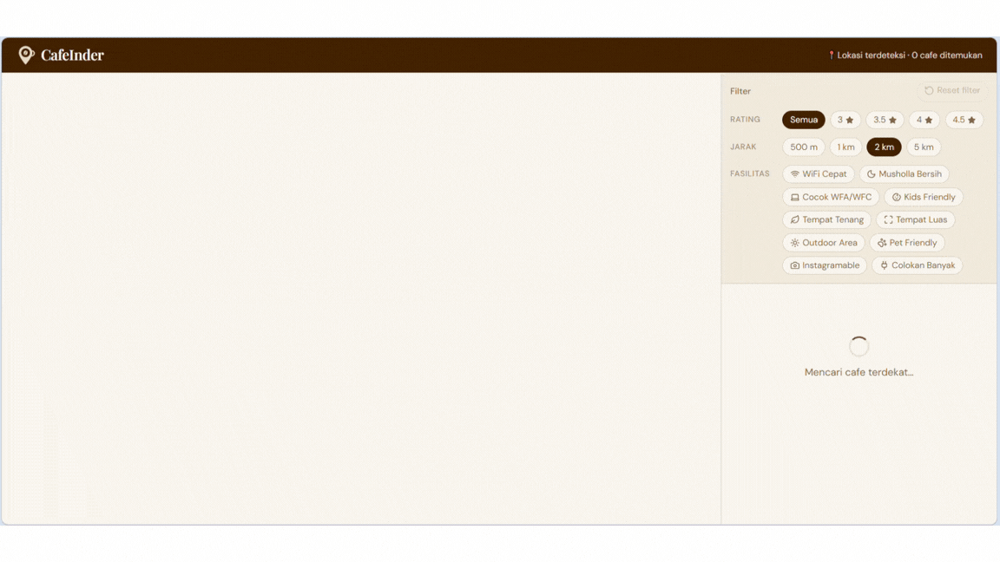

# CafeInder — Find Your Peace

Stop spending **30–60 minutes** searching for the perfect cafe to work from. Find your next WFC spot in just a few clicks!

## Background

*Have you ever spent 30 minutes to an hour just looking for a cafe to work from?*

**I did.**

Finding the right cafe for Work From Cafe (WFC) used to be a time-consuming process. I had to manually:

- Check nearby cafes, choose one.
- Read Google Maps reviews to understand the atmosphere and work-friendliness.
- Check whether the cafe had free Wi-Fi, enough power outlets, and a comfortable workspace.
- Browse photos to see the interior, seating arrangements, and available facilities.
- Check another cafe one by one.

It was frustrating and inefficient.

That's why I built CafeInder — an application designed to make finding the perfect cafe for working easier, faster, and more convenient.

## Features
### Automatic Nearby Cafe Detection

No more manually searching for cafes!

CafeInder uses **Google Maps and Google Places API to automatically detect cafes around your current location using your device's GPS**.

### Smart Filtering

Find cafes that match your working preferences with various filtering options:

* **Rating**: Filter cafes based on their Google Maps ratings.
* **Distance**: Find cafes within your preferred distance.
* **Facilities**: Filter based on available facilities, such as free Wi-Fi and power outlets.
* **Work-friendly suitability**: Discover cafes suitable for WFC (Work From Cafe), WFH (Work From Home), or WFA (Work From Anywhere).

### Cafe Photo Gallery

*Want to see what a cafe looks like before visiting?*

Each cafe card comes with a photo gallery featuring up to **10 location photos** sourced from Google Maps user reviews.

Get a better idea of the cafe's interior, seating, atmosphere, and overall environment before deciding where to work.

### Direct Google Maps Navigation

After found your ideal workspace,

Simply click the **"View Route"** button on a cafe card, and you'll be **redirected directly to Google Maps with the selected cafe as your destination**.

No need to search for the cafe all over again!

### App Demo

Here's a quick look at how CafeInder works:



### Try It Yourself!

*Ready to find your next favorite workspace?*

Give CafeInder a try and spend less time searching, more time getting things done!

Click [here](https://cafeinder-three.vercel.app/) to try the live application

## The Goal

Cafe Finder was built around a simple idea:

**Finding a place to work shouldn't take longer than actually getting work done.**

Whether you're a freelancer, remote worker, digital nomad, student, or someone who simply enjoys working outside, Cafe Finder helps you discover your next productive spot with less effort.

Built to make your next work session a little easier. ☕

## Getting Started

First, run the development server:

```bash
npm run dev
# or
yarn dev
# or
pnpm dev
# or
bun dev
```

Open [http://localhost:3000](http://localhost:3000) with your browser to see the result.

You can start editing the page by modifying `app/page.tsx`. The page auto-updates as you edit the file.

